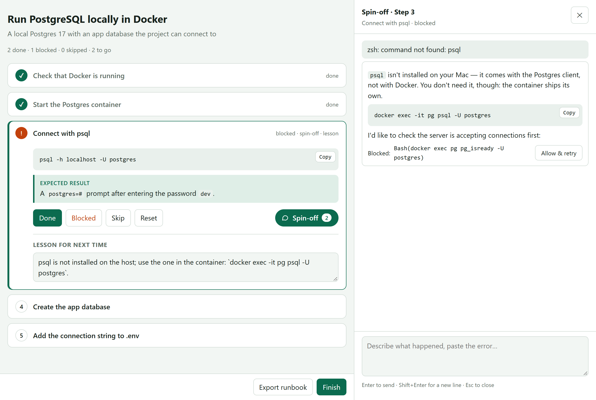

<h1 align="center">Stepflow</h1>

<p align="center">
  <b>Work through Claude's multi-step instructions one step at a time — and fix the step that breaks without losing your place.</b>
</p>

<p align="center">
  <a href="#quick-start">Install</a> ·
  <a href="#use">Use</a> ·
  <a href="#what-the-spin-off-is-allowed-to-do">Permissions</a> ·
  <a href="#troubleshooting">Troubleshooting</a>
</p>

<picture>
  <source media="(prefers-color-scheme: dark)" srcset="docs/stepflow-dark.png">
  
</picture>

When Claude gives you a ten-step procedure and step 4 fails, you either scroll back through the chat to find steps 5–10 or ask Claude to write them again. Stepflow keeps the steps and the troubleshooting apart.

|   |   |
|---|---|
| **One step at a time** | The steps open on a local page. Only the current one is expanded, with its commands (one-click Copy) and the result you should see. Mark it **Done**, **Blocked** or **Skip** and the next one opens. |
| **A Claude spin-off per step** | **Blocked** opens a side panel with a separate Claude conversation that knows the goal and every step. Fix the step there; your main chat and your place in the list stay untouched. |
| **Lessons that carry over** | **Finish** saves a `runbook.md` of what worked and what needed fixing. Hand it back to `/stepflow` next time and the fixes are built into the steps. |

## Quick start

In a terminal, add the marketplace once:

```
claude plugin marketplace add SensoryDeprivation/AI.Skills
```

Then, inside Claude Code:

```
/plugin install stepflow@AI.Skills
```

Then, after Claude gives you a list of steps (or instead of asking for one):

```
/stepflow:stepflow                                   # turn the steps Claude just gave you into a page
/stepflow:stepflow set up Postgres in Docker         # or let Claude work them out
```

## Requirements

- [Claude Code](https://claude.com/claude-code), installed and logged in, with `claude` on your `PATH`. On Windows both the native installer and npm work.
- Node.js 18 or newer.
- A browser.

There's nothing else to install: no npm packages and no build step.

## Use

| Command | What it does |
|---------|--------------|
| `/stepflow:stepflow` | Turns the multi-step instructions Claude just gave you into a flow |
| `/stepflow:stepflow <task>` | Works out the steps for `<task>` and makes a flow |
| `/stepflow:stepflow <path>/runbook.md` | Makes a new flow from a finished runbook, with its lessons built into the steps |
| `/stepflow:stepflow <flow name>` | Reopens an existing flow, with its progress |

The page opens by itself. Work through the steps top to bottom; only the current step is expanded.

- **Done** or **Skip** moves you to the next step.
- **Blocked** opens the spin-off. Describe what went wrong and press Enter to send; Shift+Enter adds a new line.
- **Summarize fix** turns the spin-off conversation into a short lesson for that step. You can also type the lesson yourself.
- **Finish** saves `runbook.md` and stops the server.

## Where things are kept

Each flow gets its own folder, `~/.stepflow/<date>-<name>/`:

- `flow.json`: the steps, their statuses, the spin-off conversations and the lessons. Progress survives closing the tab or restarting the computer.
- `runbook.md`: written when you click Export or Finish.
- `context-<step>.md`: what each spin-off was told about the procedure.

## What the spin-off is allowed to do

The spin-off is a real Claude Code session on your machine (`claude -p`). It runs in the flow's working folder, which is usually your project folder or your home folder.

- It uses your usual Claude Code permission rules, and it can also edit files **without asking** (`acceptEdits` mode).
- Anything else your rules don't allow, such as a shell command or a web fetch, is blocked. The blocked request is shown under Claude's reply with an **Allow & retry** button.
  - For a shell command, Allow & retry allows that exact command, for that step only.
  - For a tool without a command (writing outside the working folder, web fetches, MCP tools), it allows the whole tool for that step. The page marks these **whole tool**.
- Each message is a separate `claude -p` run and is cancelled after 10 minutes, along with anything it started.

The page only listens on `127.0.0.1`. Its address contains a random secret, and the server rejects any request without that secret.

## Troubleshooting

- **The browser didn't open.** Open `http://127.0.0.1:<port>/?t=<token>` yourself, using the `port` and `token` from the flow's `flow.json`. If you start the server yourself (see below), it also prints this address.
- **The spin-off says "Could not start claude".** Check that `claude --version` works in a new terminal.
- **Stopping a flow without Finish.** Stop its `node … server.mjs` process. Reopening it with `/stepflow:stepflow <flow name>` reuses the same address.
- **Running the server yourself:** `node skills/stepflow/scripts/server.mjs ~/.stepflow/<flow>/flow.json`. Add `--no-open` if you don't want it to open a browser.

## Development

The tests use Node's built-in test runner. From `skills/stepflow/`:

```
node --test test/flow.test.mjs test/claude.test.mjs test/server.test.mjs
```

(On Node 21 and newer, `node --test "test/*.test.mjs"` works too.) The tests use a fake `claude`, so they don't need a login and make no API calls.

The full test suite has passed on Windows 11 and on Linux (Debian in Docker) with Node 18, 20 and 24. macOS hasn't been tested yet.
